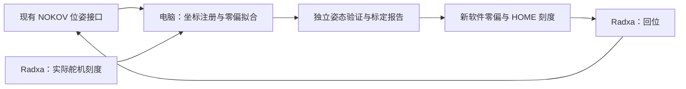

# NOKOV Mars 1.3H：Microduck 关节标定与 HOME 调整方案

日期：2026-10-02。对象：HD-1910 舵机、ID 1–14、Radxa ZERO 3W。

## 目标与已有条件

用户已有动捕数据接口，可以取得 XYZ、姿态和角速度。本方案直接使用该接口，不要求重新配置相机或网络。

目标是建立真实舵机反馈刻度与训练模型关节角度的准确对应关系，然后回到模型 HOME。永久标定偏移、方向相关的回差、承重后的跟踪误差分别记录。初版停用强化学习控制，用外部支撑完成静态采样。

现有舵机 ID 和方向沿用已实测结果：1–4、6–13 为 −1，5、14 为 +1。15 号嘴舵机不属于行走模型的 14 个控制关节。

## 一、数据接口

优先使用每组刚体的位置和四元数。若现有接口只给欧拉角，适配层必须明确单位、旋转顺序、内禀/外禀定义以及坐标轴，再转换为旋转矩阵或四元数。角速度用于判断是否静止，不替代姿态。

NOKOV 的 XRS 文档列出刚体的帧、时间戳、XYZ、四元数 qx/qy/qz/qw、欧拉角和角速度。该顺序适用于文档中的 XRS；其他接口应独立核对，不能直接套用。[官方 XRS 文档](https://docs.nokov.com/xingying/XingYing4.6-CN/shi-san-shu-ju-dao-chu/liu-xrscsv-wen-jian/)

内部统一采用米、弧度、四元数 `[qx, qy, qz, qw]`，明确旋转矩阵将局部向量变换到世界系。输入至少包含：

```text
pose_id, frame, capture_timestamp, receive_timestamp
rigid_name, position_m[3], quaternion_xyzw[4], tracking_valid, quality
servo_id, actual_position_ticks, servo_receive_timestamp
```

同一姿态记录所有相关刚体和实际舵机刻度。不能用目标刻度代替反馈。动捕若给的是每个球心的 XYZ，可用三个以上不共线、对应关系已知的球心重建刚体位姿；球体自身的旋转不作为连杆姿态。

## 二、标记安装与模型坐标注册

全身使用以下九组刚体，每组建议四个不对称、牢固固定的标记。首轮只做躯干和左腿三段，共四组。

| 刚体名称 | 实物位置 | 模型 body | 相关舵机 |
|---|---|---|---|
| duck_trunk | 躯干刚性结构 | trunk_base | 全身基准 |
| duck_l_thigh | 左大腿 | upper_leg_left | 1、2、3 |
| duck_l_shank | 左小腿 | leg | 4 |
| duck_l_foot | 左脚刚性结构 | ankle_left | 5 |
| duck_neck | 颈杆 | neck | 6 |
| duck_head | 头部刚性结构 | jaw_soft | 7、8、9 |
| duck_r_thigh | 右大腿 | upper_leg_right | 10、11、12 |
| duck_r_shank | 右小腿 | leg_2 | 13 |
| duck_r_foot | 右脚刚性结构 | ankle_right | 14 |

`jaw_soft` 在此 XML 中是头侧倾关节后的头部总成名称；标记不能装到活动嘴上。

### 推荐注册方法

用螺丝孔、轴承座或定位面固定轻量标记座，登记球心坐标相对于模型连杆的固定关系。标记座不能跨关节，也不能固定在松动外壳或线材上。

星影支持创建自定义局部坐标刚体，输入事先测得的各球心局部 XYZ，输入单位为 mm。可将这些坐标直接定义在对应模型 body 系中，或使用标记座坐标并另外保存 `T_body_marker`。普通刚体的默认朝向不能直接当作模型坐标。[官方刚体文档](https://docs.nokov.com/xingying/XingYing4.6-CN/jiu-chuang-jian-markerset/yi-rigid-gang-ti/)

操作顺序：播放并看清全部球点 → 冻结 → 选中同一连杆的点 → 创建刚体/自定义 → 输入名称和各球心 XYZ → 解除冻结 → 转动连杆核对识别 → 保存资产。

如果使用标记座坐标，记 `T_B_M` 为标记座坐标到模型连杆坐标的变换，动捕输出 `T_W_M`，则：

```text
T_W_B = T_W_M · inverse(T_B_M)
T_trunk_B = inverse(T_W_trunk) · T_W_B
```

躯干标记座也要注册，不能假定它和躯干模型坐标天然重合。只有躯干参考系采用 X 前/Y 左/Z 上；腿部模型 body 的局部轴由 XML 定义。

若缺少可用 CAD 登记，可用已校准的 NOKOV 探针测量三个以上非共线、在模型中已知的机械基准点，拟合固定变换。选择可重复定位的孔或面基准，不能把外壳中心当作旋转轴心。[官方探针文档](https://docs.nokov.com/xingying/XingYing4.6-CN/jiu-chuang-jian-markerset/liu-tan-zhen/)

不能在没有机械基准时同时自由拟合全部标记安装方向和全部关节零偏，两者可能互相补偿。

## 三、第一轮左腿采样

托住并固定躯干，支撑头部，脚悬空且留出关节活动空间。现有 Xbox 服务和网页运动控制退出，由采样程序独占串口。

使用现有标定回到大致 HOME 即可，不要求人工先摆到准确 HOME。若尚不能可靠回位，可以手动摆放后读取反馈。

1. 基准姿态记录一次。
2. 1–5 号各自相对基准向两个方向小幅变化，建议先用约 ±5°，共十个姿态。幅度以实际活动空间为准。
3. 加入 3–5 个组合姿态，单独留作验证。
4. 选取基准和两个组合姿态，从刻度增加与减少方向分别接近，检查重复性。
5. 每次停稳后采集约一秒，保存原始帧并平均。只有稳定且跟踪有效的窗口进入拟合。

首轮先用姿态编号和静止窗口对齐两端数据，避免把不同电脑的时间戳直接相减。静止条件同时参考动捕角速度、位置变化和实际刻度变化；具体阈值由静止噪声试测确定。动态标定以后再做时钟和传输延迟辨识。

标定拟合排除补点、插值和跟踪丢失数据；星影 TRC 文档说明反算点可能补齐缺失点，因此不能把这些点当作独立测量依据。[官方 TRC 文档](https://docs.nokov.com/xingying/XingYing4.6-CN/shi-san-shu-ju-dao-chu/wu-trc-wen-jian/)

## 四、零偏求解

令实际刻度为 `c_i`，已确认方向为 `s_i`，待求的软件零偏为 `z_i`：

```text
q_i = s_i · (c_i − z_i) · 2π/4096
```

将这些关节角输入训练模型的正运动学，计算各段连杆相对躯干的位置和方向。跨多个姿态联合拟合，使预测与动捕测量最接近。位置误差与旋转误差按各自测量噪声归一化，使用鲁棒损失降低异常帧影响。

初版只拟合关节零偏，方向、刻度比例和机械几何保持已核对值。检查雅可比秩和参数不确定度；如果髋部某些关节难以区分，增加中间髋件标记或增加独立变化姿态。

如果标记注册和模型几何已知，一个姿态在条件满足时也能局部求零偏。多姿态的作用是提高精度、验证方向和区分变化性误差。

原训练 HOME 保持不变，新 HOME 刻度为：

```text
c_HOME,i = z_i + s_i · q_HOME,i · 4096/(2π)
```

不修改舵机 EEPROM，不再次把当前位置统一定义为 2048。当前部署按单圈 0–4095 使用，目标跨越边界时需要单独处理安装/校零，不能取模掩盖问题。

## 五、实际回 HOME 与小步闭环

1. 在未参与拟合的姿态上验证候选配置。
2. 用候选零偏计算 HOME 刻度，先在支撑状态下缓慢回位。
3. 从动捕重新估计实际关节角 `q_measured`，比较训练 HOME。
4. 残余误差需要调整时，每轮最多约 0.5°，等待 0.5–1 秒稳定后重新测量。这个数是初版设计参数，不是已验证的真机参数。
5. 连续三次测量均达到约 1°以内，可作为初步到位目标；若改善停滞，检查负载、标记注册和几何，不继续累计大修正。

每轮按关节角误差转换刻度：

```text
Δq = q_HOME − q_measured
Δc = s · bounded(Δq) · 4096/(2π)
```

标记丢失时暂停新修正，不继续追踪无效数据。标定阶段始终有外部支撑，并保留操作员停止入口。

当前承重或特定接近方向下的修正量保存为独立记录，不能全部写入永久零偏。落地后重复测量，用来区分结构弹性和舵机跟踪误差。模型脚部参考坐标不等同于实物曲面鞋底；目标取自 HOME 正运动学，不额外强制两个脚参考系都水平。

## 六、计算和软件分工



电脑运行模型计算、采样管理和误差显示。Radxa 读取舵机、执行回位，保持串口单一控制者。第一阶段采用离线记录和拟合；第二阶段接入实时反馈。初版不用在 Radxa 上安装动捕厂商原生库，也不引入 ROS 依赖。

后续软件模块：`capture_adapter` 接现有输出；`servo_recorder` 采集反馈；`calibration_solver` 拟合偏移；`home_verify` 检查到位；`calibration_writer` 备份并保存配置。现有 `record_reference()` 只接受预设参考姿态，需要新增动捕多姿态保存路径。

## 七、产物与验收

已有设计辅助文件位于 `reference_materials/nokov_mars13h/design/`：

- `home_target_poses.json`：从当前模型计算的九段连杆相对躯干 HOME 位姿，包含模型哈希、关节顺序和精确 HOME。
- `marker_registry.template.json`：刚体与连杆对应关系；实测球心和注册变换留空，不能直接用于运动。
- `export_home_targets.py`：重新生成模型目标的纯离线脚本。

实际标定后再生成：原始采样文件、候选 `robot.mocap_candidate.json`、新旧零偏比较、独立验证误差、双向和承重误差，以及最终 HOME 刻度。

约 1°是试验验收目标，不是 Mars 型号自动保证的精度。只校准角度映射通常不需改变训练 HOME；若连杆长度或轴位与模型不同，需要同步修正几何并重新验证策略。

## 官方资料的本地位置

`reference_materials/nokov_mars13h/official/` 已保存原始 Mars1.3H 参数 PDF 和相关官方网页正文快照。网页快照不包含截图或 SDK 二进制安装包。下载来源、获取方式见 `source_index.json`。

本文件是实施设计。尚未连接实际动捕数据、拟合这台机器人的新零偏或执行真机回位。
