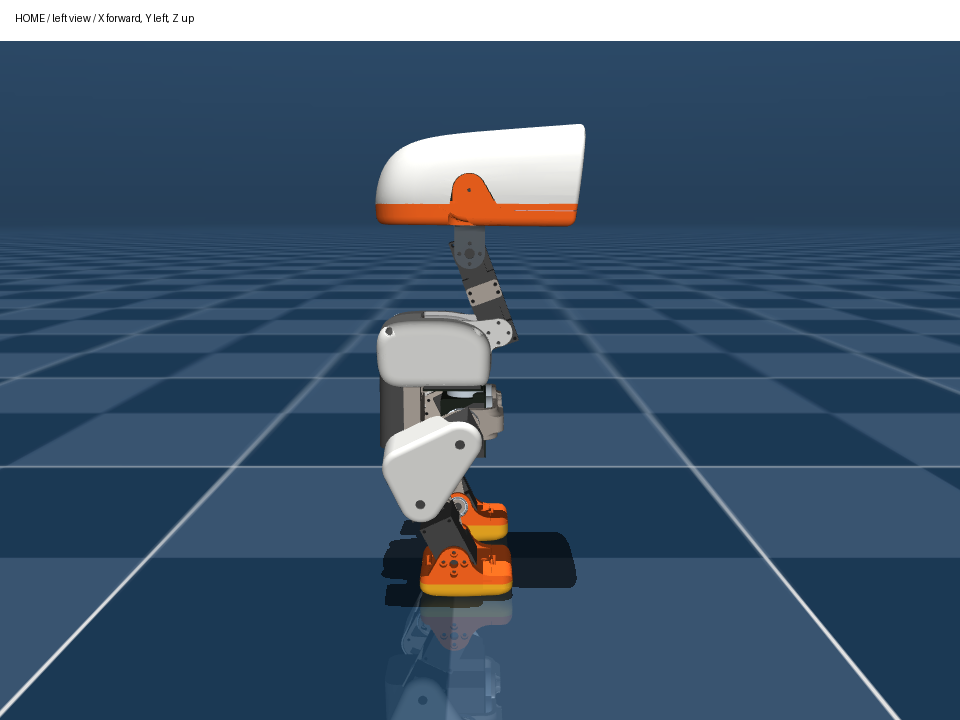

# 新机从脚装配：舵机居中、孔位定档、按几何生成标定

适用对象：用全新 HD-1910 舵机装另一台 Microduck，采用 8 孔、45° 等分舵盘。**不沿用旧机器的 `robot.json`、零位或实测方向。** 本流程把精细摆姿标定换成“已知孔型相位 + 已知连接件几何 + 安装档号”；不需要装完再摆一次 ZERO 或 straight。

目前已核对本地装配 PDF、组件图、BOM、零件对照表和训练 XML。可以确定装配链、模型角定义和 HOME；**这些资料没有给出 HD-1910 在读数 2048 时的孔型相位，也没有给 14 个关节定义带编号的 0 档孔。不能从旧图直接编出一套可靠档号。** 新入口会拒绝尚未填写、尚未复核的数据。

## 1. 先明确三个角度基准

| 名称 | 含义 | 本方案是否必须摆到这里 |
|---|---|---|
| 舵机中立位 | 单圈编码器读数 `2048` | 每颗装配前转到这里，并确认实际反馈 |
| 模型 ZERO | 14 个模型关节角全部为 `0` | 不必；它只定义角度计算基准 |
| 训练 HOME | 策略的默认站姿，14 个角并非全零 | 几何标定验证后，由程序缓慢转到这里 |

模型坐标为 X 向前、Y 向左、Z 向上；左右均指机器人自身。关节角是相邻刚体之间绕该关节轴的角，不能把连接件相对桌面的倾角直接填进去。

HOME 读自训练 `HOME_FRAME` 和部署 `policy.py`，不是早期的髋/踝 ±30° 站姿，也不是 `straight`。下表为显示近似值，程序使用原始 rad 数值：

已分别核对普通/HD训练源码与部署的14个数值完全一致；可下载[HOME角度表 CSV](../../reports/20261030_assembly_geometry/home_reference.csv)。这张表只有模型角，实机目标刻度还需要本机的装配几何数据。

| ID（本机采用的编号方案） | 关节 | HOME / rad | HOME / ° |
|---:|---|---:|---:|
| 1 | left_hip_yaw 左髋偏航 | 0 | 0 |
| 2 | left_hip_roll 左髋侧倾 | −0.0873 | −5.00 |
| 3 | left_hip_pitch 左髋俯仰 | −0.4579 | −26.24 |
| 4 | left_knee 左膝 | −0.0049 | −0.28 |
| 5 | left_ankle 左踝 | +0.4530 | +25.95 |
| 6 | neck_pitch 颈俯仰 | +0.3491 | +20.00 |
| 7 | head_pitch 头俯仰 | +0.3491 | +20.00 |
| 8 | head_yaw 头偏航 | 0 | 0 |
| 9 | head_roll 头侧倾 | 0 | 0 |
| 10 | right_hip_yaw 右髋偏航 | 0 | 0 |
| 11 | right_hip_roll 右髋侧倾 | +0.0873 | +5.00 |
| 12 | right_hip_pitch 右髋俯仰 | +0.4579 | +26.24 |
| 13 | right_knee 右膝 | +0.0049 | +0.28 |
| 14 | right_ankle 右踝 | −0.4530 | −25.95 |



另见 [HOME 正面](images/home_front.png)、[ZERO 侧面](images/zero_left.png)。HOME 的膝角接近 0°，不表示腿笔直：训练零姿本身就带有连接件固定偏角。颈俯仰和头俯仰的正轴相反，不能把两个 +20° 简单当作头相对地面低下 40°。

## 2. 准备零件与装配记录

使用同一版本的飞特改件，尤其不要混用 XL330 和 HD-1910 的舵盘配合件。来源和版本说明见 [CAD 仓库 README](../../microduck-replica-cad/README.md)。其 PDF/组件图仍是旧版 XL330 图，适合辨认组件，不能充当 HD 八孔中位相位图。

- 两侧脚：`sole_left/right`、`foot_left/right`、`ankle_left/right`。
- 两侧腿：`leg`、左右上腿、上腿加固板、`hip_l`、`yaw2roll`、`bearing_roll`；左右数量以实际总装引用为准。
- 躯干、颈两侧连接件、`neck_pitch` U 形件、`yaw_roll_motion`、头部支架及外壳。
- 舵机 15 颗：14 颗策略关节，嘴部 ID 15 独立处理。单盘/双盘位置按所用飞特版本总装核对。
- BOM 列出轴承 10×15×3 共 3 个、16×22×4 共 11 个；6×12×3 是轮滑变体使用，普通脚不需要。
- BOM 列出的螺丝为 M2×5、M2×6、M2.5×6，数量写“若干”；**没有逐孔长度表**。先以实物孔深、夹持厚度及所用舵机允许旋入深度核对，不把长螺丝拧到底当作锁紧。原版网格的[紧固件反推](../../microduck-replica/docs/紧固件反推.md)只能辅助，不能代替飞特改件配合尺寸。

准备小螺丝刀、卡尺、直角尺、支撑夹具及记号笔。每颗舵机贴 ID 和关节名；每个转动连接拍下可辨认壳体、输出盘标记及连接件基准的照片。

**最少记录四项：**该舵机的 2048 孔型朝向；此连接件的 0 档基准；实际安装档号；编码器方向。8 个孔外观相同，若没有永久基准标记，“第几个孔”无法复现。

## 3. 装配前逐颗居中和编号

先完成单颗再接下一颗，避免新舵机同 ID 冲突。舵机暂不带连杆，连接飞特半双工 USB 转接板并按其要求供电。在电脑执行：

```bash
cd ~/microduck/microduck-replica/tools/servo-web
python3 -m venv .venv
.venv/bin/python -m pip install -r requirements.txt

# 不知道出厂 ID 时，先只读扫描；完成后该程序退出
.venv/bin/python servo_report.py --port /dev/ttyUSB0 --scan-all

# 已确认舵机 ID 后启动网页；1–15 为本次使用的编号
.venv/bin/python server.py --port /dev/ttyUSB0 --ids 1-15
```

浏览器打开 `http://127.0.0.1:8080`。确认真实串口已连接、该颗实际在线，不能在模拟模式下判断成功。若扫描读出的出厂 ID 不在 1–15，启动时把该 ID 也加入 `--ids`。

1. 用[飞特 FD 工具](../../microduck-replica/tools/飞特/README.md)逐颗写入第 1 节分配的 ID：选实际 COM 口和匹配波特率，搜索单颗，写 ID，断电重连并读回，再贴标签。退出 FD 后再用网页居中。**现有网页“改 ID”下拉仍是上游旧编号，不能用它直接选全套 1–15**；`--ids` 只改变扫描列表，不改下拉，也不会改硬件 ID。Linux 下已有 Rust 环境时，可用本地[测试工具](../../microduck-replica/tools/FeeTech_HD1910M_Servo/TUTORIAL.md)的 `cargo run -- --port /dev/ttyUSB0 --id 旧ID set-id 新ID`，一次只接一颗，完成后重新扫描确认。
2. 读取并保存原寄存器记录，尤其是内部位置偏移。**只转到 2048，不点击“中位校准/一键校准”，不改内部偏移。**
3. 开扭矩前先把目标对齐实际读数；再开启扭矩，把过渡时间设为约 3 秒，发 `2048` 位置目标。
4. 等实际反馈稳定在 2048 附近，再确认输出盘相对壳体的朝向。标出一个孔作为盘基准、标出壳体基准和观察面；双盘两侧分别记录，换观察面会反转视觉上的顺/逆时针。
5. 用夹具保持位置，卸力后安装。轴若在拧螺丝时转动，需要重新确认。不要借助舵机保持力去硬扳输出盘或拧紧连接件。

这是逐颗裸舵机居中流程。整机连杆装好后，不应直接广播“全部回 2048”：此时是否能到达 2048 及经过何处，取决于装配档位与机构空间。

## 4. 先把孔位变成可计算的几何数据

每个关节单独建立以下约定，左右不共用未经确认的符号：

1. **0 档：**明确指定连接件的哪个孔/边，对应舵盘的哪个已标记孔。拍照或在 CAD 图上标明；观察方向也写清。
2. **`base_q_deg`：**舵机实际为 2048、按这个 0 档装配时，对应的模型关节角。它包含孔盘中位相位和连接件固定偏角，未必是 0°，也未必是 45° 的倍数。
3. **`hole_steps`：**相对 0 档实际挪了几档，按“模型关节角增大”为正，每档 45°；不是统一按看上去顺时针计正。范围 −7…7，保留真实安装分支，不用取模掩盖绕圈。
4. **`direction`：**模型关节角增大时，编码器增加为 +1、减小为 −1。与上面的档号符号是两个概念。

于是：

```text
装配参考模型角 q_ref = base_q_deg + 45 × hole_steps
zero_tick = 2048 − direction × q_ref × 4096/360
HOME_tick = 2048 + direction × (HOME_deg − q_ref) × 4096/360
```

**如何取得 `base_q_deg`：**在实际采用的 HD 总装中，找出固定壳体、转动连接件及模型关节坐标；把实测/厂家保证的“2048 时孔型相对壳体方向”代入，按定义的 0 档配合，计算相对模型零姿的转角。CAD 默认打开时的装配姿态，不等于已验证的编码器 2048。若 CAD 没有这个电气—机械对应关系，需首次用定位工装测定孔型相位；只需建立可靠基准，不要求每次装机都精细摆全机。

8 孔只能确定相邻档差 45°，不能确定起始相位。**舵盘与打印件的螺钉孔位、舵盘与输出轴的花键，是两个安装层级。** [HD-1910-C001 规格书](../../microduck-replica/tools/FeeTech_HD1910M_Servo/HD-1910-C001串型规格书20260907.pdf)印刷第 3/7 页列出输出轴为 25T/OD4.95 mm，即花键每齿 14.4°；本页 45° 指舵盘的八孔安装档，不是花键齿距。若拆下舵盘并改变它在输出轴上的安装位置，原中位孔型基准就失效，不能仍按同一份 45° 档表使用。

全新舵机也要确认厂商是否保证相位一致；若不保证，逐颗记录实际相位。相位精度决定最终模型角精度，`verified=true` 只是你的确认记录，软件无法用编码器自己证明孔位选对。[飞特结构设计页](https://ftservo.github.io/ftservo-wiki/products/models/hd-1910-c001/mechanical/)也分别要求确认图纸零位、电气零位、方向及行程；其尺寸图用于核对结构，不提供本机的编码器—孔位标定。

### 厂家没有保证中位相位时：用单舵机工装补齐

这比人工摆整机容易重复。先为实际版本设计一个有确定角度的定位工装，再逐颗读取编码器：

1. 用舵机壳体安装面/孔定位壳体，用两根定位销约束输出盘上明确的一对孔；注明哪面朝外及哪个孔为首孔。壳体与孔线关系由工装保证，不靠目测精细调角。
2. 根据实际连接件 CAD 和同一 0 档定义，算出这个工装状态对应的模型角 `q_fixture`。**裸电机相对桌面的角度本身不是模型角，仍要加上固定装配几何关系。**
3. 裸舵机通电卸力，轻动输出盘使它进入工装，不写内部中位校准；记录静止时的实际刻度 `t_fixture`，确认同一单圈分支和已实测 `direction`。
4. 计算 `base_q_deg = q_fixture + direction × (2048 − t_fixture) × 360/4096`。保存工装图、`q_fixture`、`t_fixture` 及方向作为 `datum` 依据。
5. 取下会阻挡转动的定位销/工装，再让裸舵机转回 2048；按所选 45° 档安装连接件。不同舵机分别读数，不能因为同批次就直接复用 `t_fixture`。

工装设计和几何关系要先精确确定一次；之后装配者只负责壳体入位、孔销入位和读刻度。若没有可靠 CAD 基准或工装，仍不能声称已经省掉全部角度测量。

**选档原则：**在结构能装入、连杆和线束不干涉、目标落在硬件/模型范围内的候选档中，优先选参考姿态接近 HOME 的档。若 8 档均可用，最近档距离 HOME 不超过 22.5°；真实机构未必允许 8 档全部使用。还要检查策略所需角范围能否落在单圈范围内，不能只看 HOME 刻度是否有效。

例如头偏航模型允许 ±170°，总行程 340°。要在 2048 两侧容纳全部行程，中位对应的模型角必须约在 ±10° 内。若 `base_q_deg=20°`，所有45°档都可能不满足这个条件；不能把20°改填成0°骗过检查。需要重新设计/核对机械配合与中位孔型基准；若改变舵盘花键位置或内部偏移，必须重建该颗的基准记录。

仅为演算，**不是某个实机关节的装配参数**：假设 `base_q_deg=0`、`hole_steps=1`、`direction=+1`，则 q_ref=45°。若该关节 HOME=20°，算得 zero_tick=1536，HOME_tick≈1764；机械仍然装在 45° 档，软件转 −25° 到 HOME。实际表必须用该关节自己的基准和训练 HOME。

## 5. 从脚向上装两条腿

这是把原说明书的躯干向下顺序改成“先做腿子总成，再连接躯干”。每一级仍按其子总成先装轴承、预埋/被遮挡紧固件及走线，不能等整条腿连好才补无法接近的螺丝。

| 次序 | 左侧 / 右侧 | 工作与对应关节 | 参考图 |
|---|---|---|---|
| 1 | 左脚 / 右脚 | 区分足尖方向，组合鞋底、脚件、踝架，装配对应支承轴承；暂不接腿 | [左踝脚](../../microduck-replica-cad/组件图/06-左踝脚.png)、[右踝脚](../../microduck-replica-cad/组件图/15-右踝脚.png) |
| 2 | ID 5 / 14 | 踝舵机壳体装进小腿子总成；输出盘与脚踝架按本关节选定档位连接，另一侧支承同轴。记录踝的相位/档号 | [左小腿](../../microduck-replica-cad/组件图/05-左小腿.png)、[右小腿](../../microduck-replica-cad/组件图/14-右小腿.png) |
| 3 | ID 4 / 13 | 预装大腿子总成内的膝舵机、髋俯仰舵机、轴承及加固板；将小腿上端接膝输出端，确定膝档位 | [左大腿](../../microduck-replica-cad/组件图/04-左大腿.png)、[右大腿](../../microduck-replica-cad/组件图/13-右大腿.png) |
| 4 | ID 3 / 12 | 将大腿的髋俯仰轴与 `hip_l` 髋支架连接，选髋 pitch 档；确认轴承与输出盘同轴 | [左髋 roll 支架](../../microduck-replica-cad/组件图/03-左髋roll.png)、[右髋 roll 支架](../../microduck-replica-cad/组件图/12-右髋.png) |
| 5 | ID 2 / 11 | 将髋支架接到 `yaw2roll` 内的 roll 舵机，装另一侧 `bearing_roll` 支承，记录 roll 档位 | [左 yaw-roll 组件](../../microduck-replica-cad/组件图/02-左髋.png)、[右 yaw-roll 组件](../../microduck-replica-cad/组件图/11-右髋.png) |
| 6 | ID 1 / 10 | 预装躯干的 yaw 舵机和支承，将两条腿子总成分别接到其输出端，记录 yaw 档位 | [躯干爆炸图](../../microduck-replica-cad/组件图/01-躯干主体-爆炸图.png) |

注意“关节在链条上的位置”不等于“电机壳体在哪个子总成”：大腿内同时有髋 pitch 和膝舵机，小腿内有踝舵机，yaw-roll 子总成内有髋 roll 舵机，髋 yaw 舵机在躯干。不能把组件序号 01–15 当作电机 ID。

每接好一级：检查同轴和间隙 → 对角分步锁紧 → 通电卸力读数 → 轻动该轴检查方向与局部自由度 → 返回已记录装配参考并读回。其它零件未连接时就确认方向，更容易看到单独是哪一轴在动。不要以碰撞到机械止挡作为零点。

正方向详表见 [零位标定操作步骤第 2 节](零位标定操作步骤.md#2-确认-id-和正方向)。例如左踝模型正转是足尖下压，右踝模型正转是足尖上抬；左右镜像不代表配置中的方向自动取同号或反号。

## 6. 接躯干、颈部和头部

先让躯干由支撑架承重；两脚此时只是完成装配的末端，不要求机器人自己站住。电池、电路板、线束应按最终布局预留重量与活动空间。

1. **颈俯仰 ID 6：**在 `neck` 两侧连接件之间预装上下两颗俯仰舵机，将下端轴接到躯干，按该轴的 0 档与实选档定位。
2. **头俯仰 ID 7：**颈上端轴连接 `neck_pitch` U 形件，分别记录本轴的相位/档号；不要把“颈竖直”误认为头俯仰也自动是 0°。
3. **头偏航 ID 8：**连接 U 形件与 `yaw_roll_motion` 子总成，核对绕头部竖轴左右转的自由度。
4. **头侧倾 ID 9：**连接头部总成与 yaw-roll 支架，核对绕前后轴侧倾的自由度；头内支架、轴承、线束先装，最后合壳。
5. **嘴部 ID 15：**单独装配和标定开/闭端点，不写入本次 14 关节几何表，不把嘴的机械闭合强行等同于编码器 2048。

参考：[颈根组件](../../microduck-replica-cad/组件图/07-颈根.png)、[U 形件](../../microduck-replica-cad/组件图/08-颈俯仰.png)、[yaw-roll 组件](../../microduck-replica-cad/组件图/09-头yawroll.png)、[头部爆炸图](../../microduck-replica-cad/组件图/10-头部总成爆炸1.png)。

**旧 PDF 的两处名称不能照字面理解：**“02 左髋”实际是 yaw-roll 组件，不是 ID 3 的髋 pitch；“07 颈根”包含两个 pitch 轴，实际训练链没有在这里定义颈 yaw。以本页关节链及训练 XML 为准。

## 7. 创建本机几何表并离线预览

本入口是 **2026-10-30 新增代码**，之前的 10 月 28 日源码压缩包不包含它。新主板完成系统、串口与依赖准备后，从当前工作区复制最新版部署目录；基础环境步骤见[完整复现手册](../../README-从零复现.md)。电脑执行下面两条时，替换新主板的用户名和 IP，不能沿用旧机器地址：

```bash
scp -r ~/microduck/deploy_hd1910 新主板用户名@新主板IP:~/
ssh 新主板用户名@新主板IP
```

进入新主板后执行 `cd ~/deploy_hd1910`、`bash install.sh`。这是首次新机部署；如果目标目录已有本机 `robot.json`，先确认其归属，不用另一台机器的配置覆盖。

以下 `~/deploy_hd1910` 指**新机器人自己的部署目录**。若在旧电脑/旧板上离线整理另一台机的配置，给各条 `run.sh` 命令在子命令前加 `--config robot.new.json`，避免使用旧 `robot.json`。该独立配置最终作为新机器人自己的 `robot.json` 使用；后面的 `scripts/supported_home.py` 和 Xbox 入口固定读取部署目录的 `robot.json`，不能在旧机器目录中直接照跑。不要把新表套到之前调试的那台机器。

```bash
cd ~/deploy_hd1910
./run.sh init
./run.sh map-ids --profile servo_ids.user.json
```

`init` 不覆盖已有文件；`map-ids` 只记录编号，不改变舵机内部 ID，也不确认方向。新机要设置实际串口、波特率和 IMU 信息，逐颗用 `watch` 确认 ID/方向，再用 `map-joint` 记录。例如仅在本机实测为 −1 时：

```bash
./run.sh watch --id 5 --seconds 20
./run.sh map-joint --joint left_ankle --id 5 --direction -1
```

全部 14 项确认后生成独立模板：

```bash
./run.sh assembly-template --output assembly_geometry.json
```

模板不覆盖已有文件。填写 `geometry_source`（实际飞特 CAD/打印件版本及中位相位依据），逐项填写以下字段：

也可先打开[空白表样例](../assembly_geometry.example.json)了解格式；其中角度、档号、方向未填写，不能直接用于实机。

| 字段 | 填什么 |
|---|---|
| `name`、`id`、`direction` | 本机实际映射；必须与已确认的配置一致 |
| `center_tick` | 本方案为 2048 |
| `base_q_deg` | 第 4 节定义的 0 档模型角；未测明时保持 `null` |
| `hole_steps` | 按模型正方向计数的真实档差，−7…7 的整数 |
| `datum` | 0 档如何对孔、从哪面观察、中位相位如何确认、照片/图纸位置 |
| `verified` | 完成机械基准、相位、实际档位复核后才设为 `true` |

顶层 `schema=1`、`type="microduck_assembly_geometry"`、`hole_pitch_deg=45` 保持不变。不要为了让程序通过而把未知角度填 0、批量确认全部项。

```bash
# 纯计算预览；不连接串口、不保存 robot.json、不驱动舵机
./run.sh assembly-calibrate --profile assembly_geometry.json --output logs/assembly-plan.json

# 逐项核对报告后保存；备份原配置，仍不连接或驱动舵机
./run.sh assembly-calibrate --profile assembly_geometry.json --apply
```

保存的是 `assembly` 标定：参考模型角、参考刻度、ID/方向快照、软件零点和 HOME 目标。不是把读数重新写成 2048 的硬件校准。程序还会检查装配参考角在模型限位内，以及**模型全部关节行程**换算后都落在单圈 0–4095；不是只验证 HOME。真正舵机的硬件限位在下一节读回检查。几何表、照片及报告要与新机配置一并保留。

## 8. 实物验证，再缓慢移到 HOME

退出占用串口的网页/其它控制程序，先保持新机被支撑、舵机卸力。确认单圈位置模式、分辨率和硬件限位：

```bash
./run.sh inspect
./run.sh watch --angles --seconds 30
```

逐颗核对：刻度 2048 附近时，显示角应接近表里的 `q_ref`；沿模型正方向移动已知小角度，显示角应增加同样角度。**刚生成标定后的数值自洽不证明物理角正确**，至少用独立基准核对足部、髋轴、颈轴和头部方向。

作为模型几何核查，ZERO 下髋俯仰轴在膝轴前 35.7771 mm、上 22 mm；膝踝轴间距 42 mm；颈两俯仰轴间距 50 mm。它们不是本方案要求的装配姿态，只用于查 CAD 是否改变了轴间关系。若结构几何不一致，不能仅靠角零偏补偿连杆长度变化。

让所有关节保持在各自装配参考附近，先只读预览：

```bash
./run.sh home-plan --from-pose assembly --move-seconds 12
```

预览要求当前姿态接近已保存参考、映射与零点未变、起终点满足单圈和限位检查；它不等于真实机构已通过碰撞检查。若关节在装配中离开中位，可在通电卸力和支撑下逐颗轻动，读数确认回到参考附近；不要对整机直接广播居中。
若提示12秒的目标速度过高，可把 `--move-seconds` 增至14–30秒重新预览；下面的支撑脚本会自动计算所需时间。

首次只验证 HOME，可使用支撑状态的脚本，不需要启动策略或依赖 IMU 平衡：

```bash
# 预览，不运动
.venv/bin/python scripts/supported_home.py --target home --soft-gains

# 确认路径后执行；躯干及头部受支撑，双脚留空，撤掉阻挡运动的定位夹具
.venv/bin/python scripts/supported_home.py --target home --soft-gains --move
```

装配参考下，该脚本至少用12秒、按位移自动延长至最多30秒，目标峰值速度不超过12°/s；成功后保持 HOME 扭矩，托稳后用 `./run.sh relax` 卸力。也可在完成 [IMU 方向验证](Radxa与IMU接线.md) 后使用常规命令：

```bash
./run.sh home --from-pose assembly --move-seconds 12 --seconds 3 --enable-motion
```

常规命令结束会卸力。两种方式择一，均不要求重新摆 straight。若出现腿扭转、脚尖朝错、头向反方向运动或零件顶住，停下检查档号、孔型相位和方向，不改训练 HOME 掩盖错误。

按 HOME 图确认姿态后，再完成本机 IMU、嘴部和手柄检查，进入 [Xbox 部署流程](../README.md)。新机的串口、方向、IMU 安装方向、嘴部端点均不能从旧机器直接复制。以后机械配合、内部偏移和舵机不变时，不必每次开机重做几何标定。

现有 Xbox 的 A 回 HOME 已支持 `assembly` 标定，不要求直腿标定记录。该分支日常允许模型限位内的起点、按位移自动延长时间，并保留电压/电流/跟踪/到位检查；包装器传入 `--log-only-feedback` 也不会关闭这些装配分支检查。第一次仍先执行上面的只读预览和受支撑 HOME 验收。

## 依据与当前缺口

- [机械行者 Robo 装配说明书](../../microduck-replica-cad/安装说明书/microduck装配安装说明书.pdf)：已阅读并核对组件图；旧图使用 XL330。
- [装配 BOM](../../microduck-replica-cad/BOM/装配BOM-机械行者Robo-2026-09-16-带采购链接.xlsx)、[零件—刚体对照表](../../microduck-replica/cad/零件对照表.json)：组件归属和外购件规格；不提供电气中位孔型相位或逐孔螺丝长度。
- 已下载保存作者 v2.1 的[飞特改动打印件 STEP 压缩包](../../reference_materials/hd1910_assembly/STEP-changed-parts-FT-2026-09-25.zip)及[来源/校验值](../../reference_materials/hd1910_assembly/sources.json)。这10个改动件可辅助核对配合孔，但不含完整舵机/总装的2048相位定义。
- [训练 HOME](../../microduck_rl/src/mjlab_microduck/robot/microduck_constants.py)、[训练关节和几何](../../microduck_rl/src/mjlab_microduck/robot/microduck/robot_walk.xml)、[部署角度定义](../microduck_deploy/policy.py)。
- **仍需从新机实物/带基准工程图取得的量：**14 个舵机 2048 孔型相位、各连接件 0 档定义与 `base_q_deg`、实际 `hole_steps`、逐颗实测方向，以及飞特改件对模型几何的匹配。现有图片不足以可靠填满这张表。

本页装配图片链接指向机械行者 Robo 的复刻资料，模型姿态图基于 Pollen Robotics Microduck；沿用相应 CC BY-NC-SA 声明，见 [NOTICE](../NOTICE.md)。

代码验证：2026-10-30，部署测试 **748项通过，另有115项子检查通过**，包括合成几何、正负方向/45°偏置、拒绝未知/过期数据、只读预览、模拟600步HOME及Xbox路径。见[测试结果](../../reports/20261030_assembly_geometry/pytest.xml)。这验证软件计算与控制流程，不代表新机的实际孔位、装配精度或碰撞路径已验证。
